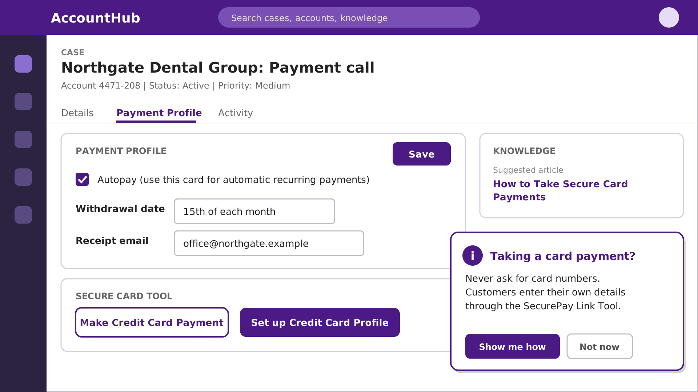
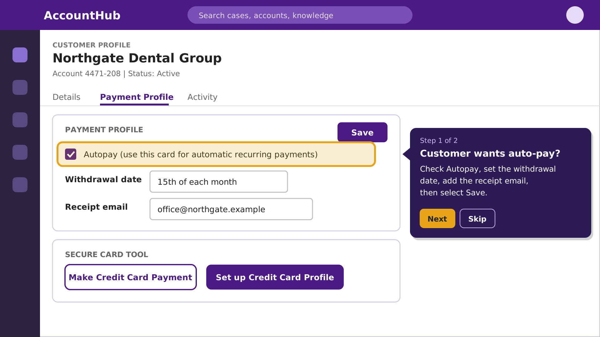
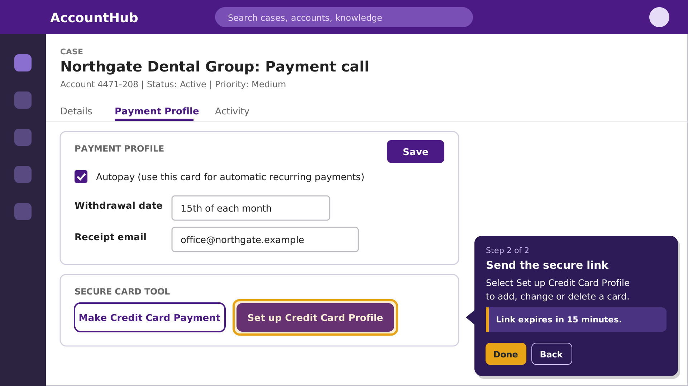
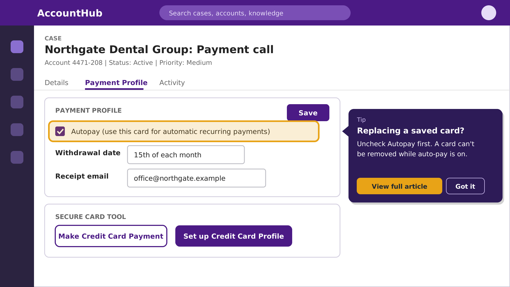

**Salesforce In-App Guidance & Related Articles**

> **About this sample:** Recreated in-app guidance based on content I built with the Salesforce In-App Guidance app for a national telecom provider. The platform, company and data are fictional. AccountHub is modeled as a Salesforce page, and the secure payment tool is a separate web application, so the guidance covers the Salesforce side.

**See also:** [Knowledge article: Credit Card Payments and Changes with the SecurePay Link Tool](../README.md)

---

**The problem**

Agents on payment calls follow a security-sensitive process with several rules that are easy to miss: never take card numbers, the secure link expires in 15 minutes, and a card can't be replaced while auto-pay is on. Mistakes happen mid-call, when agents have no time to search an article.

**The approach**

Put short guidance on the page agents already use, at the moment they need it, and link to the full knowledge article for depth.

---

**1. Welcome prompt**

*Trigger: the agent opens the Payment Profile tab.*

A docked prompt reminds agents never to ask for card numbers. "Show me how" starts the walkthrough, and "Not now" lets experienced agents skip it. The Knowledge panel surfaces the full article.

**2. Walkthrough, step 1 of 2: auto-pay**

*Trigger: the agent selects "Show me how."*

The Autopay row is highlighted, and the message covers the four actions in one short sentence: check Autopay, set the date, add the email, save.

**3. Walkthrough, step 2 of 2: launch the tool**

The launch button is highlighted, with the 15-minute expiry warning shown at the step where agents send the link.

**4. Targeted prompt: preventing a known error**

*Trigger: the agent is on a case where a saved card may be replaced.*

This prompt attaches to the Autopay checkbox in AccountHub and stops the "can't remove card" error in the SecurePay Link tool before it happens. The "View full article" links to the full procedure.

---

**Design decisions**

- **Triggered by the task.** Prompts appear where the work happens, not in a separate help area.
- **One action per message.** Each prompt covers a single step and stays short enough to read mid-call.
- **Warnings at the point of risk.** The link expiry and the auto-pay rule sit on the exact element where agents make the mistake.
- **Prevention over explanation.** The last prompt avoids an error instead of explaining it afterward.
- **Link to depth.** Prompts stay brief and point to the knowledge article for the full procedure.
- **Easy to skip.** Agents can dismiss any prompt, so experienced staff aren't slowed down.

**How I would measure it**

- Prompt views, "Show me how" starts, walkthrough completions and dismissals
- Clicks on "View full article"
- Call-handling errors that the guidance targets, such as expired links and failed card removals
- Agent feedback after the first few weeks, used to shorten or retire prompts that aren't helping
